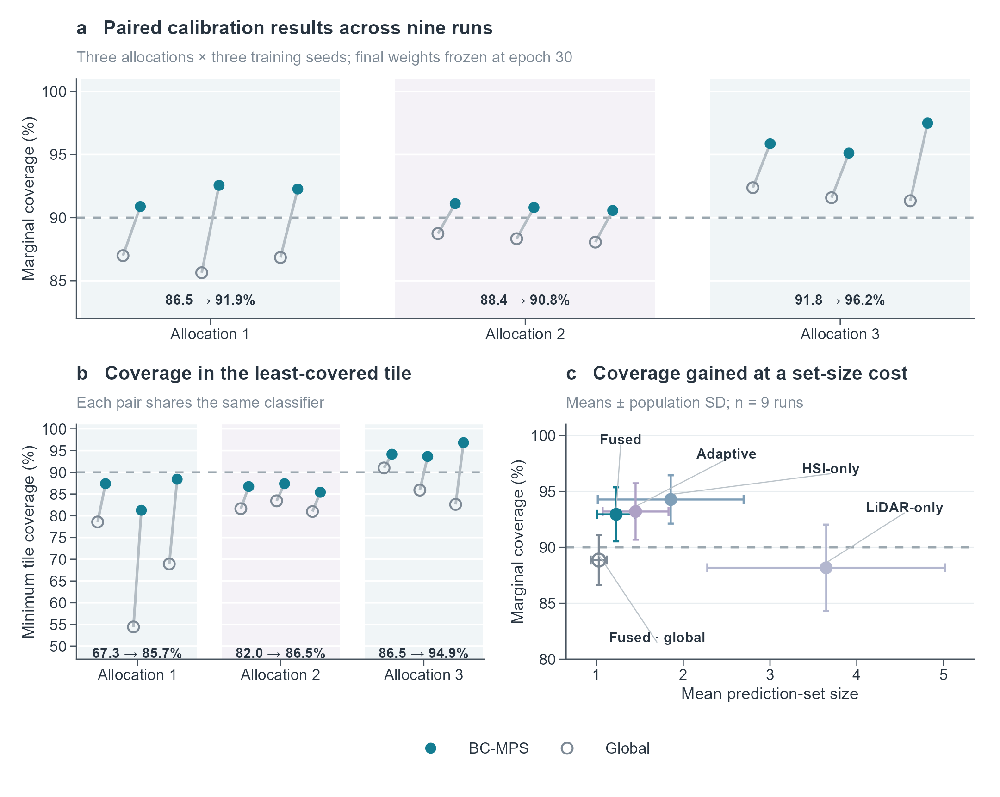

# BC-MPS

**Block-Conformal Multimodal Prediction Sets for Spatially Separated Hyperspectral-LiDAR Classification**

[中文说明](README.zh-CN.md) | [Reproduction guide](docs/REPRODUCIBILITY.md) | [Data preparation](data/README.md) | [MIT license](LICENSE)

This repository contains the implementation, final-epoch model weights, configurations, and recorded results accompanying the manuscript. BC-MPS converts frozen HSI-LiDAR class probabilities into candidate-class sets. It computes within-tile score thresholds and combines them with a corrected upper order statistic. For the three nonempty calibration tiles and the specified outer level, that statistic is their maximum.

## Recorded experiment

The manuscript uses the MUUFL Gulfport Campus 1 scene, three fixed spatial allocations, and three training seeds: nine runs in total. Each classifier is trained for exactly 30 epochs with a simulated training-label replacement probability of 0.40. Complete 11 x 11 input-patch supports are separated between training, calibration, and testing. Global and blocked calibration use identical frozen probabilities.

| Fused-probability metric | Pixel-pooled calibration | BC-MPS |
| --- | ---: | ---: |
| Mean empirical coverage | 88.87% | 92.96% |
| Mean of per-run minimum test-tile coverage | 78.61% | 89.02% |
| Mean prediction-set size | 1.0283 | 1.2279 |

The nominal coverage target is 90%. BC-MPS produces singletons for 87.06% of retained test centers on average. The calibration comparison leaves argmax decisions unchanged. These recorded values summarize this scene and protocol; the construction and sampling interpretation are described in [the reproduction guide](docs/REPRODUCIBILITY.md).

## Quick start

### 1. Verify saved results without installing scientific packages

Python 3.11 is the tested runtime. Run these commands from the repository root:

```bash
git clone https://github.com/y3519712124-ui/BC-MPS.git
cd BC-MPS
python scripts/verify_artifacts.py
```

This checks release checksums, six original source snapshots, nine checkpoints, their 30-epoch histories, and all saved summary means and standard deviations. It requires only Python's standard library. It checks recorded evidence; it does not retrain a model.

### 2. Install dependencies and run a synthetic example

```bash
python -m venv .venv
# Linux/macOS: source .venv/bin/activate
# Windows PowerShell: .venv\Scripts\Activate.ps1
python -m pip install -r requirements.txt
python scripts/demo.py
python -m unittest discover -s tests -v
```

The example is explicitly synthetic and is separate from the experimental results. Core dependencies are NumPy, SciPy, and PyTorch. For the CUDA environment used by the recorded experiments, install the matching wheel first:

```bash
python -m pip install torch==2.7.1 --index-url https://download.pytorch.org/whl/cu128
python -m pip install -r requirements.txt
```

The recorded environment used Python 3.11.9, NumPy 2.4.6, SciPy 1.17.1, PyTorch 2.7.1+cu128, and an NVIDIA RTX 4060 Laptop GPU with 8 GB of VRAM. [Environment details](artifacts/environment.json) include precision settings. CPU checks and CUDA evaluation have different purposes; cross-device floating-point thresholds can differ.

### 3. Prepare official data and evaluate the released weights

Obtain the original MAT file from the [MUUFL data owners](https://github.com/GatorSense/MUUFLGulfport), following [the data instructions](data/README.md). Source imagery and annotations remain at their upstream source.

```bash
python scripts/prepare_data.py --source /path/to/muufl_gulfport_campus_1_hsi_220_label.mat
python scripts/evaluate_checkpoints.py --device cuda --output-root reproduced_evaluation
python scripts/run_diagnostics.py --output-root reproduced_evaluation
```

Use `--device cpu` if CUDA is unavailable. Choose a new output directory when repeating an evaluation. The evaluation script recomputes predictions from the released weights and reports numerical differences from the saved results. The diagnostic script uses all nine probability arrays for the fixed operating-point grid and matched spatial-score controls.

### 4. Train from scratch

```bash
python scripts/run_experiment.py --device cuda --output-root reproduced_training
python scripts/run_diagnostics.py --output-root reproduced_training
```

This runs all nine fixed-30-epoch experiments. To train only one specified run, append `--splits 20261031 --seeds 0`; the complete diagnostic requires all nine runs. Training uses the final epoch without calibration-label checkpoint selection. Portable wrappers call the archived computations directly. Existing incomplete runs are preserved rather than overwritten.

### 5. Plot the recorded numerical results

The two data figures are included in `docs/figures/`. To regenerate the R plots, install `ggplot2`, `patchwork`, `svglite`, and `ragg`, then run from the repository root:

```bash
Rscript scripts/plot_paper_figures.R
```

Outputs are PDF, SVG, and PNG under `reproduced_figures/`. The script reads recorded numerical CSV files. The historical plot labels "HSI-only" and "LiDAR-only" denote auxiliary heads from the same jointly trained network; they are not separately trained unimodal models. Plot typography may vary with available system fonts.



## Repository structure

```text
BC-MPS/
  code/original_snapshot/      Exact six-file source snapshot for primary runs
  code/fixed_budget_posthoc.py Recorded post-training diagnostic computation
  scripts/                    Supported portable reproduction entry points
  configs/paper.json          Manuscript settings and seeds
  artifacts/checkpoints/      Nine final-epoch weights and run provenance
  artifacts/paper_results/    Nine-run records, summaries, diagnostics, plot data
  artifacts/environment.json Recorded software/hardware environment
  data/                       Upstream acquisition instructions and provenance
  docs/                       Reproduction guide and recorded data figures
  tests/                      Calibration, spatial-support, and architecture checks
  SHA256SUMS.json              Release-file checksums
  CITATION.cff                 Software citation metadata
```

`reproduced*/`, local datasets, raw images, credentials, caches, and local manuscript files are excluded from Git. Serialized weights contain the model state dictionary and epoch number; `evaluate_checkpoints.py` loads them with `weights_only=True`.

## Method references and attribution

- Duchi, J. C., Gupta, S., Jiang, K., & Sur, P. (2025). Predictive inference in multi-environment scenarios. *Statistical Science, 40*(3), 392-416. https://doi.org/10.1214/24-STS973. The two-level calibration construction is attributed to this foundation.
- Zhang, Z., & Sabuncu, M. R. (2018). Generalized cross entropy loss for training deep neural networks with noisy labels. *NeurIPS, 31*. Used in the fixed probability-source training objective.
- Liu, K., Sun, T., Zeng, H., Zhang, Y., Pun, C.-M., & Vong, C.-M. (2025). Spatial-aware conformal prediction for trustworthy hyperspectral image classification. https://doi.org/10.1109/TCSVT.2025.3558753. Spatial-score controls adapt its neighborhood operator to the same pointwise scores and retained-center protocol.
- Dataset attribution is listed in [data/README.md](data/README.md).

The SACP comparison is a matched operator control, rather than a reproduction of that paper's benchmark. Earlier exploratory datasets and variable-checkpoint results are outside this release. No SERT, FIDN, EQTransformer, or other third-party implementation is bundled here.

## Citation and license

Use [CITATION.cff](CITATION.cff) to cite this software. The associated manuscript title appears above; no journal-acceptance claim or article DOI is assigned in this repository. Original code and accompanying model weights are distributed under the [MIT license](LICENSE). Upstream datasets and scientific publications retain their respective terms.
